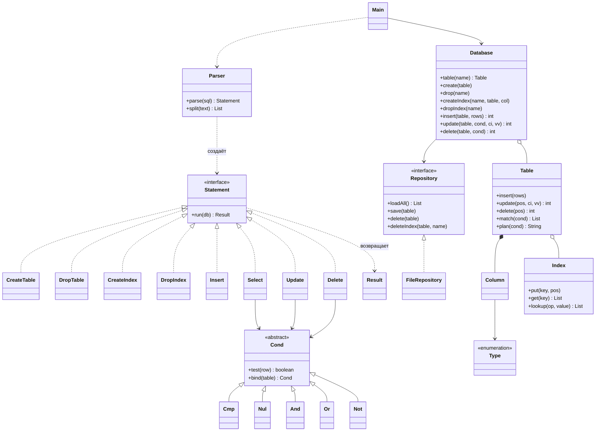
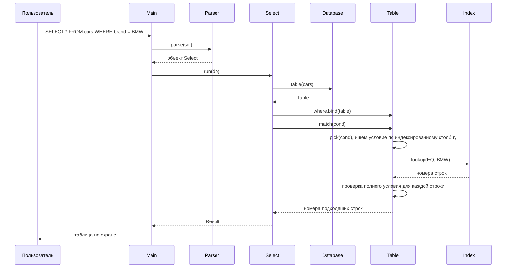
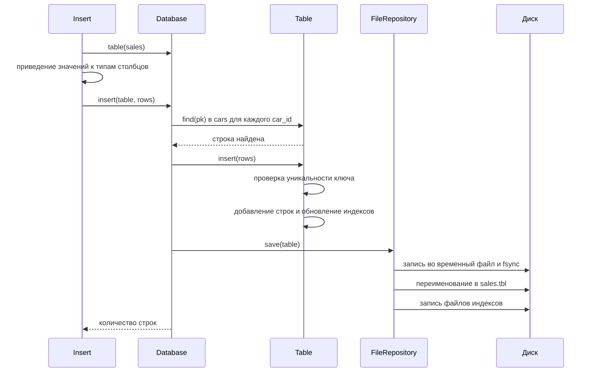

# Лабораторная работа 2. Простая СУБД на Java

Небольшая СУБД с SQL-подобным языком запросов. Таблицы хранятся в файлах на диске, при запуске всё загружается обратно. Есть первичные и внешние ключи, индексы и консольный интерфейс.

Предметная область - автосалон. Две таблицы, связанные по ключу:

- `cars (id INT PK, brand STRING, price DOUBLE, in_stock BOOL)` - машины;
- `sales (id INT PK, car_id INT -> cars, buyer STRING, day DATE)` - продажи, `car_id` ссылается на `cars.id`.

Вместе они покрывают все пять типов: целое, дробное, строка, дата, логическое.

## Что умеет

- `CREATE TABLE`, `DROP TABLE`
- `CREATE INDEX`, `DROP INDEX`
- `INSERT INTO` (одна или несколько строк, можно с указанием столбцов)
- `SELECT` со списком столбцов или `*`, `WHERE` с `AND`, `OR`, `NOT`, скобками, `IS NULL`
- `UPDATE ... SET ... WHERE`
- `DELETE FROM ... WHERE`
- проверка уникальности первичного ключа, проверка внешних ключей, `NULL` в необязательных столбцах
- результат `SELECT` печатается таблицей

Типы в `CREATE TABLE`: `INT`, `DOUBLE`, `STRING`, `DATE`, `BOOL` (ещё принимаются `INTEGER`, `FLOAT`, `VARCHAR`, `TEXT`, `BOOLEAN`). Дата пишется строкой `'2026-03-14'`.

## Архитектура

Код разложен по трём пакетам:

- `dbms.db` - сама база: типы, столбцы, таблицы, индексы, условия, класс `Database`;
- `dbms.sql` - разбор запросов (`Parser`) и классы запросов (`Select`, `Insert` и т.д.);
- `dbms.store` - работа с диском (`FileRepository`).

`Main` - консоль, `SelfTest` - проверки, `Bench` - замеры скорости.

Использованы такие шаблоны:

- **Repository / DAO**: `Database` ничего не знает про файлы, она работает через интерфейс `Repository`. Сейчас реализация одна, `FileRepository`, но её можно заменить на другую без правок в `Database`.
- **Command**: каждый запрос после разбора превращается в объект с интерфейсом `Statement` и методом `run(Database)`.
- **Iterator**: `Table` реализует `Iterable<Object[]>`, по строкам можно ходить через `for`.
- **Composite**: условие `WHERE` - это дерево из `Cond.Cmp`, `Cond.And`, `Cond.Or`, `Cond.Not`, `Cond.Nul`.

### Диаграмма классов



### Диаграмма последовательности: SELECT с индексом



### Диаграмма последовательности: INSERT



## Как хранятся данные

В папке `data/` (её можно поменять аргументом запуска) лежат:

- `cars.tbl`, `sales.tbl` - таблицы целиком, это сериализованный объект `Table` (`ObjectOutputStream`). Внутри схема, строки, описания индексов и номер версии;
- `cars.idx_cars_brand.idx` и подобные - по одному файлу на каждый индекс, созданный через `CREATE INDEX`.

Индекс первичного ключа отдельно не сохраняется: он строится в памяти при загрузке, это быстро.

Строки таблицы хранятся как `Object[]`, а в индексе лежит `TreeMap` из значения в список номеров строк.

### Надёжность

После каждого изменяющего запроса таблица сразу сохраняется. Сохранение сделано так:

1. данные пишутся во временный файл `*.tmp`, потом вызывается `fsync`;
2. временный файл переименовывается в настоящий (атомарная операция, если её поддерживает файловая система).

Поэтому если программа упадёт во время записи, настоящий файл останется старым и целым. Недописанные `*.tmp` удаляются при следующем запуске.

У таблицы есть счётчик версии `ver`, он растёт при каждом изменении. Индекс при записи запоминает версию таблицы, с которой он согласован. Таблица пишется раньше индексов, поэтому после аварии версия индекса может быть только старее таблицы. При запуске версии сравниваются, и если индекс не совпал или файл повреждён, он просто перестраивается из данных таблицы (в консоль выводится сообщение). Так индексы не могут тихо разойтись с данными.

Проверки на оба случая есть в `SelfTest`.

### Ограничения

Я не делал лишнего, поэтому есть вещи, которых нет:

- при каждом изменении таблица пишется на диск целиком, поэтому тысячи одиночных `INSERT` подряд на больших таблицах медленные (массовая вставка одним `INSERT ... VALUES (...), (...)` быстрая);
- нет транзакций, каждый запрос атомарен только в пределах одной таблицы;
- нет `JOIN`, `ORDER BY`, `GROUP BY`, агрегатных функций;
- внешние ключи работают в режиме "запретить": нельзя удалить или изменить строку, на которую кто-то ссылается;
- работает один пользователь, без блокировок.

## Индексы

`CREATE INDEX idx_cars_brand ON cars (brand);` строит `TreeMap` по столбцу. Значения `NULL` в индекс не попадают (они всё равно никогда не проходят сравнение).

Индекс при `SELECT`, `UPDATE`, `DELETE` используется так:

1. условие `WHERE` разбирается на части, соединённые `AND`;
2. ищется первая часть вида `столбец <op> значение`, где по столбцу есть индекс и операция не `!=`. Равенство важнее диапазона;
3. по индексу берутся номера кандидатов: `=` это точный поиск, `<`, `<=`, `>`, `>=` это выборка части дерева;
4. для каждого кандидата ещё раз проверяется всё условие целиком, поэтому остальные части `AND` не теряются.

Если на верхнем уровне стоит `OR`, `NOT` или нет подходящего индекса, читается вся таблица. Индекс первичного ключа используется так же, как и обычные.

После каждого `SELECT` в последней строке написано, как он выполнялся: `(индекс idx_cars_brand)` или `(полный перебор)`.

`INSERT` просто дописывает новые строки в индексы. При `DELETE` у строк сдвигаются номера, поэтому индексы таблицы перестраиваются целиком. `UPDATE` перестраивает индексы только если меняется индексированный столбец (в том числе первичный ключ).

## Результаты тестирования производительности

Класс `Bench` создаёт таблицу `cars` с 10 тысячами, 100 тысячами и 500 тысячами строк. Марка случайная из 1000 вариантов (`brand0`...`brand999`), цена случайная от 0 до 100000. Сначала запросы выполняются без индексов, потом создаются `idx_cars_brand` и `idx_cars_price`, и те же запросы выполняются снова. Время считалось вместе с разбором запроса и построением результата. Каждое измерение это медиана из 5 серий.

Запросы:

1. `SELECT * FROM cars WHERE brand = 'brand500'` (около 0,1% строк)
2. `SELECT * FROM cars WHERE price > 99900` (около 0,1% строк)
3. `SELECT * FROM cars WHERE brand = 'brand500' AND price > 50000`

Выполнял на MacBook Air M4 16/512.

| Строк | Запрос | Найдено | Без индекса, мс | С индексом, мс | Ускорение |
|---|---|---|---|---|---|
| 10000 | 1 | 9 | 0.112 | 0.005 | x21 |
| 10000 | 2 | 12 | 0.140 | 0.010 | x14 |
| 10000 | 3 | 6 | 0.158 | 0.007 | x23 |
| 100000 | 1 | 113 | 1.309 | 0.024 | x55 |
| 100000 | 2 | 90 | 0.615 | 0.048 | x13 |
| 100000 | 3 | 57 | 1.333 | 0.032 | x42 |
| 500000 | 1 | 525 | 7.577 | 0.039 | x197 |
| 500000 | 2 | 479 | 2.751 | 0.116 | x24 |
| 500000 | 3 | 269 | 6.558 | 0.027 | x240 |

Ответы с индексом и без индекса проверялись на совпадение, везде совпали.

Время самих замеров заметно скачет от запуска к запуску (сборщик мусора и JIT-компиляция), в соседних прогонах одни и те же ячейки отличались в несколько раз. Но картина всегда одна: без индекса время растёт вместе с размером таблицы (на 500 тысячах строк от 3 до 8 мс), с индексом почти не зависит от размера и определяется числом найденных строк (сотые и десятые доли миллисекунды). Ускорение получалось от 13 до 240 раз.

Для справки, из того же прогона:

| Строк | Вставка одной пачкой, мс | Два `CREATE INDEX` с записью на диск, мс | Загрузка базы с диска, мс |
|---|---|---|---|
| 10000 | 12 | 83 | 91 |
| 100000 | 46 | 368 | 194 |
| 500000 | 188 | 2433 | 727 |

Загрузка включает чтение таблицы и обоих индексов из файлов. Сообщений о перестройке индексов при этом не было, значит индексы восстановились именно с диска.

Чтобы повторить замеры у себя:

```
java -Xmx3g -cp out dbms.Bench
```

## Инструкция пользователя

Нужна Java 8 или новее (проверено на компиляции с `--release 8` и запуске на Java 21).

### Сборка

Linux / macOS:

```
javac -encoding UTF-8 -d out $(find src -name "*.java")
```

Windows (cmd):

```
dir /s /b src\*.java > sources.txt
javac -encoding UTF-8 -d out @sources.txt
```

### Запуск

```
java -cp out dbms.Main
```

Или с другой папкой для данных:

```
java -cp out dbms.Main my_data
```

Если в Windows вместо русских букв появляются непонятные символы, выполните перед запуском `chcp 65001` и запускайте так: `java -Dfile.encoding=UTF-8 -Dstdout.encoding=UTF-8 -cp out dbms.Main`.

### Команды

Запрос заканчивается на `;`, его можно писать в несколько строк. Несколько запросов можно написать подряд.

| Команда | Что делает |
|---|---|
| `help` | справка |
| `tables` | список таблиц и число строк |
| `desc имя` | столбцы, ключи и индексы таблицы |
| `run файл.sql` | выполнить запросы из файла (строки с `--` пропускаются) |
| `exit` | выход |

Для быстрой проверки есть файл `demo.sql`: в программе набрать `run demo.sql`.

### Примеры запросов

```sql
CREATE TABLE cars (id INT PRIMARY KEY, brand STRING, price DOUBLE, in_stock BOOL);
CREATE TABLE sales (id INT PRIMARY KEY, car_id INT REFERENCES cars(id), buyer STRING, day DATE);

INSERT INTO cars VALUES (1, 'Toyota', 25000.0, TRUE);
INSERT INTO cars (id, brand) VALUES (2, 'BMW');
INSERT INTO cars VALUES (3, 'Audi', 41000.5, TRUE), (4, 'Toyota', 18000.0, FALSE);
INSERT INTO sales VALUES (1, 1, 'Ivanov', '2026-03-14');

SELECT * FROM cars;
SELECT brand, price FROM cars WHERE price > 20000;
SELECT * FROM cars WHERE brand = 'Toyota' AND in_stock = TRUE;
SELECT * FROM cars WHERE price IS NULL OR brand = 'Kia';
SELECT * FROM sales WHERE day >= '2026-04-01';

UPDATE cars SET price = 30000 WHERE id = 2;
DELETE FROM cars WHERE brand = 'Toyota';

CREATE INDEX idx_cars_brand ON cars (brand);
SELECT * FROM cars WHERE brand = 'Audi';

DROP INDEX idx_cars_brand;
DROP TABLE sales;
```

Пример вывода (так он выглядит в программе, фрагмент `demo.sql`):

```
> INSERT INTO cars VALUES (1, 'Lada', 9000.0, TRUE);
Ошибка: Повтор первичного ключа: 1
> INSERT INTO sales VALUES (3, 99, 'Sidorov', '2026-04-10');
Ошибка: В таблице cars нет записи с ключом 99
> SELECT brand, price FROM cars WHERE price > 20000;
+--------+---------+
| brand  | price   |
+--------+---------+
| Toyota | 25000.0 |
| Audi   | 41000.5 |
+--------+---------+
Строк: 2 (полный перебор)
> DELETE FROM cars WHERE brand = 'Toyota';
Ошибка: Нельзя удалить строку с ключом 1, на неё есть ссылки
> CREATE INDEX idx_cars_brand ON cars (brand);
Индекс idx_cars_brand создан
> SELECT * FROM cars WHERE brand = 'Audi';
+----+-------+---------+----------+
| id | brand | price   | in_stock |
+----+-------+---------+----------+
| 3  | Audi  | 41000.5 | true     |
+----+-------+---------+----------+
Строк: 1 (индекс idx_cars_brand)
```

Правила, которые стоит знать:

- имена таблиц, столбцов, индексов и ключевые слова не зависят от регистра;
- строки пишутся в одинарных кавычках, кавычка внутри строки удваивается: `'it''s'`;
- число без точки можно записывать в `DOUBLE`-столбец (`price = 30000`), наоборот нельзя;
- не указанные в `INSERT` столбцы получают `NULL`, кроме первичного ключа, он обязателен;
- сравнение с `NULL` делается только через `IS NULL` / `IS NOT NULL`;
- при ошибке запрос ничего не меняет (например, пачка из нескольких строк с одной повторной вставляется либо вся, либо никак).

## Тестирование

`SelfTest` - обычная программа без JUnit, запускается так:

```
java -cp out dbms.SelfTest
```

Она создаёт базу во временной папке и проверяет 53 случая: вставку (в том числе пачкой), дубликаты ключей, внешние ключи, `UPDATE`/`DELETE` с условиями, `NULL`, даты, `AND`/`OR`/`NOT`, то что результат с индексом и без индекса одинаковый, что индекс не устаревает после `UPDATE`/`DELETE`, перезапуск базы с чтением с диска, повреждённый файл индекса, брошенный `.tmp`, удаление индекса и таблицы. Последняя запущенная проверка: 53 из 53.

Документацию по коду можно собрать так:

```
javadoc -encoding UTF-8 -d docs -sourcepath src -subpackages dbms
```

## Автор

Выполнил Шанин Родион Сергеевич 25КНТ3

## Выводы

В результате получилась работающая небольшая СУБД: данные переживают перезапуск, ключи проверяются, запросы разбираются собственным парсером без сторонних библиотек. Индексы заметно ускоряют выборки по условию: на 500 тысячах строк запрос по марке стал быстрее в десятки и сотни раз (в разных прогонах от 30 до 500), при этом результат совпадает с полным перебором.

## Использованные источники

1. Лейкин М. В. Лекции по курсу "Программирование на языке Java", лекции 1-6 (презентации): классы, исключения, потоки ввода-вывода и сериализация, стандартная библиотека.
2. Oracle. The Java Tutorials. https://docs.oracle.com/javase/tutorial/
3. Документация Mermaid (синтаксис диаграмм классов и последовательностей). https://mermaid.js.org/